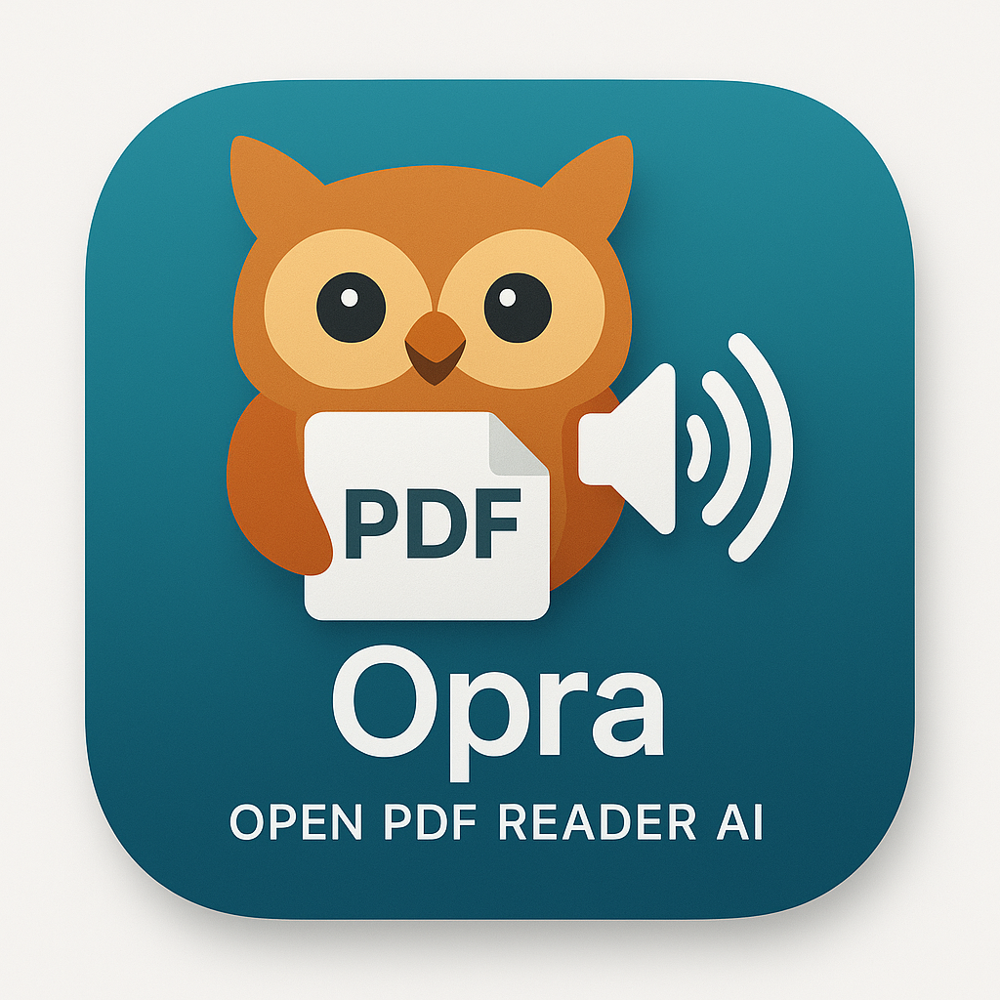
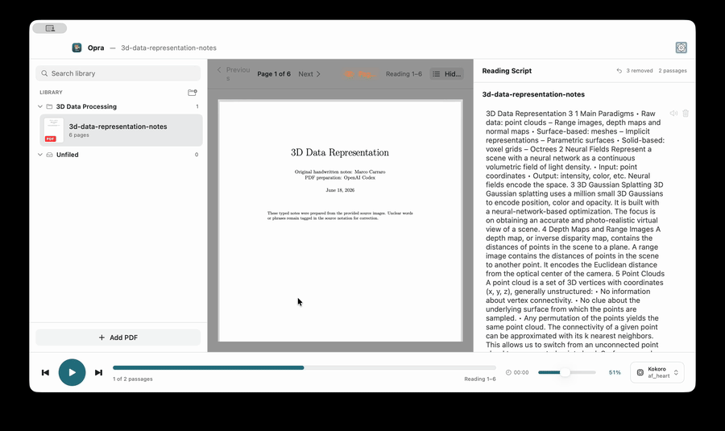

# Opra — PDF Reader AI





Opra reads PDF documents aloud using AI-powered text-to-speech. **The macOS app is the actively developed product.** A Windows port exists as a scaffold but is **not yet shipping** — see the [Roadmap / TODO](#roadmap--todo).

## How it works

Opra follows a simple three-step process:
1. **Extract** text from your PDF file
2. **Convert** text to speech using AI voices
3. **Play** the audio with progress tracking and follow-along highlighting

```
PDF → Extract Text → AI Speech → Audio Playback
```

## Quick Start (macOS)

1. **Add a PDF**: import a document into the library
2. **Open it**: select the document to build its reading script
3. **Pick a voice**: choose System, OpenAI, on-device Kokoro, or Ollama / Phonon from the transport bar
4. **Start reading**: press play, then control play/pause, skip, and speed from the transport bar (⌘, opens Settings)

## Key Features (macOS)

- **Four TTS providers**
  - **System** — macOS built-in voices (offline)
  - **OpenAI** — high-quality cloud voices (API key stored in the Keychain)
  - **Kokoro** — open-source neural voice running fully **on-device** (Apple Silicon; one-time ~330 MB model download). This is the default provider.
  - **Ollama / Phonon** — local English speech through Ollama 0.40.11+ on Apple Silicon, with a discoverable voice catalog.
- **Page-level reading** — each page becomes a single reading passage, so playback and highlighting track the document a page at a time
- **Reading script** — play from any passage, remove passages from the queue, and **restore removed passages** at any time
- **Follow-along highlighting** and page sync while it reads
- **Speed control**, progress tracking, and resume where you left off
- **Library** with folders, thumbnails, and persistent reading state (SwiftData)
- **Automatic updates** via Sparkle

## Voice Quality Options

### OpenAI (cloud)

For cloud voices, enable OpenAI Text-to-Speech in Settings:

- Model: `gpt-4o-mini-tts`
- Best built-in voices: `marin` or `cedar`
- Other voices: `alloy`, `ash`, `ballad`, `coral`, `echo`, `fable`, `nova`, `onyx`, `sage`, `shimmer`, `verse`
- Fallback models: `tts-1-hd` for quality, `tts-1` for lower latency

**Lifecycle:** OpenAI has announced January 6, 2027 retirement for these Speech API models. The recommended replacement, `gpt-realtime-2.1-mini`, requires a Realtime API implementation; it cannot be substituted into `/v1/audio/speech`. See the [provider review](docs/speech-provider-review.md).

The app stores the OpenAI API key in the macOS Keychain and splits long passages into smaller speech requests automatically.

### Kokoro (on-device, default)

Kokoro-82M is a lightweight, Apache-2.0 open-weight neural TTS that runs entirely on your Mac — no internet required. Opra downloads the model once (~330 MB) and synthesizes each page as model-sized segments behind the scenes. Requires an Apple Silicon Mac.

### Ollama / Phonon (local)

1. Install or upgrade [Ollama](https://ollama.com/download/mac) to **0.40.11 or later** on an **Apple Silicon Mac**, and open Ollama.
2. In Terminal, run `ollama pull phonon` once.
3. In Opra, choose **Ollama** in the transport bar, then open **Settings → Voices & Providers**.
4. Click **Check connection & refresh voices**, select a voice (for example Hugh if available), and use **Preview voice** or read a PDF.

Opra connects only to `http://localhost:11434`; no API key is needed. Keep Ollama running. The selected voice persists across launches. The integration uses the default English `phonon` model (31M, Apache 2.0); multilingual/40M models are not selected automatically. This is a separate local service, not an embedded runtime or automatic installer.

Long pages are split into sentence-aware requests of at most 1,200 Unicode scalars. Each response is buffered as 24 kHz mono 16-bit PCM and wrapped in a finite WAV for the shared player. Playback is **chunked**, not live audio streaming. Pause/resume, stop/skip, playback speed, and page-level highlighting use the existing transport; word progress is estimated from playback duration, not forced alignment. Errors explain how to start Ollama, install Phonon, or update the runtime. There is no silent cloud fallback.

Ollama's current Phonon runtime requires Apple Silicon. Windows/Linux speech support is not enabled in Opra. See the [speech documentation](https://docs.ollama.com/capabilities/speech) and [provider review](docs/speech-provider-review.md).

### Speech-to-text note

Opra is currently a text-to-speech PDF reader. If speech-to-text is added later, use OpenAI `gpt-4o-transcribe` for higher quality, `gpt-4o-mini-transcribe` for lower cost/latency, or `gpt-4o-transcribe-diarize` when speaker labels are required. For fully local transcription, prefer WhisperKit on Apple platforms or whisper.cpp for broad local CPU/GPU support.

## Requirements (macOS)

- macOS 15.0 (Sequoia) or later
- Apple Silicon Mac for the on-device Kokoro voice (System and OpenAI voices work on any supported Mac)
- PDF files with readable text (not scanned images)

## Download & Installation (macOS)

### Option 1: Download the pre-built app

1. Go to the [Releases page](https://github.com/kekko7072/Opra/releases)
2. Download the macOS `.dmg`
3. Drag Opra to your Applications folder and launch it

The macOS app is code-signed and notarized by Apple, so it runs without security warnings.

### Option 2: Build from source

```bash
git clone https://github.com/kekko7072/Opra.git
cd Opra/macos
open Opra.xcodeproj
# Build and run in Xcode (⌘R)
```

> **Toolchain:** the macOS app and its Swift package dependencies require **Xcode 26 / Swift 6.2** (for example, `MLXUtilsLibrary` ships a `swift-tools-version: 6.2` manifest). CI selects the latest stable Xcode on the runner accordingly.

## Releasing (macOS)

Releases are produced by the `Build and Release` GitHub Actions workflow, which builds, code-signs, notarizes, and publishes a `.dmg` + `.app.zip` whenever a version bump lands on `main`. Use the helper script to cut one:

```bash
./release.sh            # prompts for the new version (and build) number, then pushes
```

The script bumps `MARKETING_VERSION` / `CURRENT_PROJECT_VERSION` in the Xcode project, commits the bump, and pushes to `main` to trigger the release.

## Roadmap / TODO

- [ ] **Windows app** — a WinUI 3 port lives under [`windows/`](./windows) but is **not yet shipping**. It currently targets System.Speech / iText7 and lacks the OpenAI and on-device Kokoro providers, page-level reading, and the passage recovery features of the macOS app. Bringing it to parity is tracked here.
- [ ] Speech-to-text / transcription (see note above)
- [ ] Additional on-device voices / languages

## Project Structure

```
Opra/
├── macos/                 # macOS SwiftUI application (active)
│   ├── Opra.xcodeproj
│   └── Opra/
├── windows/               # Windows WinUI 3 application (TODO — not shipping)
│   ├── Opra.sln
│   └── Opra/
├── build.sh               # Build helper (macOS/Linux)
├── build.bat              # Build helper (Windows)
├── release.sh             # macOS release helper (version bump + push)
└── README.md
```

## Development

### macOS (active)

**Prerequisites**
- Xcode 26 or later (Swift 6.2)
- macOS 15.0 or later

```bash
cd macos
open Opra.xcodeproj   # ⌘R to build & run
```

**Architecture:** SwiftUI + PDFKit + AVFoundation, with four pluggable TTS engines (System / OpenAI / on-device Kokoro via MLX / Ollama Phonon) behind a common `TTSEngine` protocol. A shared `AudioPlaybackController` drives chunked synthesis/playback for the audio-producing providers.

Run the offline speech regression suite with `bash scripts/test-speech.sh` (Swift toolchain required). It exercises request limits, Unicode/long-token handling, word offsets, PCM/WAV encoding, model/voice compatibility, mocked Ollama responses and cancellation. The macOS CI job runs it before building the app.

### Windows (TODO)

> 🚧 The Windows app is a planned port and is **not yet at parity** with macOS. The notes below describe the existing scaffold.

**Prerequisites**
- Visual Studio 2022 or later
- .NET 8.0 SDK
- Windows 10 SDK (10.0.19041.0 or later)

**Architecture:** WinUI 3 with iText7 and System.Speech.

**Note:** Windows App SDK applications cannot be built on Linux/macOS due to Windows-specific build-tool dependencies. Build the Windows version on a Windows machine/VM or a Windows CI runner.
